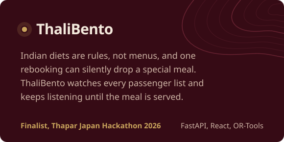
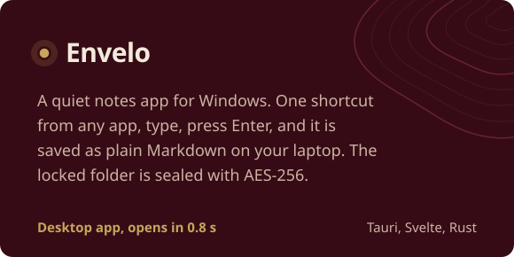

  
  

I'm a Computer Engineering student at Thapar Institute in Patiala. I like taking something tangled, like a huge codebase, an airline's special-meal pipeline or the law as it applies to a 10-year-old, and building the tool that helps people find their way around it.

These days I'm deep in AI agents and code search. I write my algorithms in C++ and ship web apps in TypeScript, and I go looking for hackathons with hard problem statements.

 

<table>
  <tr>
    <td width="50%"></td>
    <td width="50%"></td>
  </tr>
  <tr>
    <td width="50%"></td>
    <td width="50%"></td>
  </tr>
</table>

### Field notes

- Built Cartograph, an AI code-search agent that finds the right function on the first try 53% of the time, against 28% for a grep-based agent, on a 4 GB laptop GPU
- Finalist at Thapar Japan Hackathon 2026 (Japan Airlines track): led a team of three building ThaliBento in a 24-hour offline final, and built its lost-meal watcher that reads airline passenger lists and catches meals dropped by rebookings
- Building Saksham, a game that teaches children their legal rights, now playable in English and Hindi; it started as my Smart India Hackathon 2026 entry and became my software engineering project
- Built Khairiyat, NFC medication check-ins for families living apart, which reached Round 2 of Cosmicathon 2026
- Won Founder Mode: A Live Project Evaluation (Nov 2025) with an LLM fine-tuning project
- Building Pramaan, a real-time payment risk engine, for the BIOS Hackathon
- Solved 150+ DSA problems in C++
- Seeking SDE internships for summer 2027

### Contribution trail

<picture>
  <source media="(prefers-color-scheme: dark)" srcset="https://raw.githubusercontent.com/bhavyammisra/bhavyammisra/output/trail-dark.svg" />
  
</picture>

  

