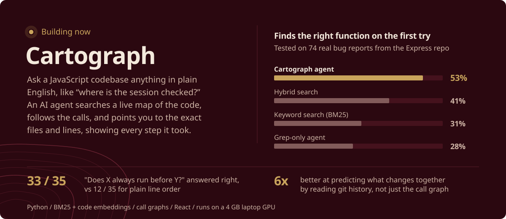
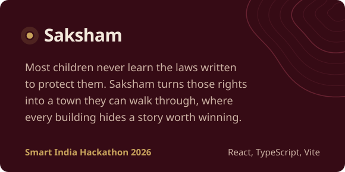
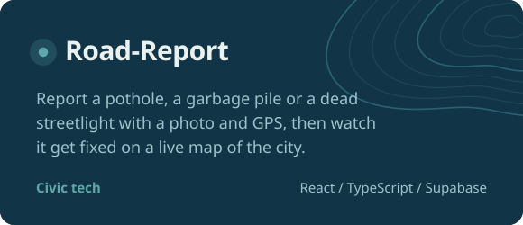
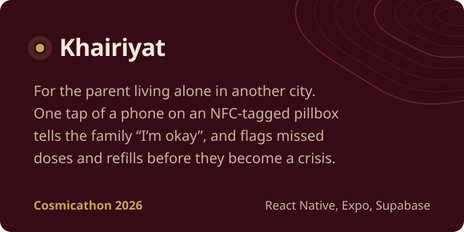
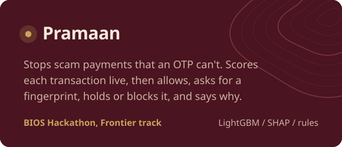
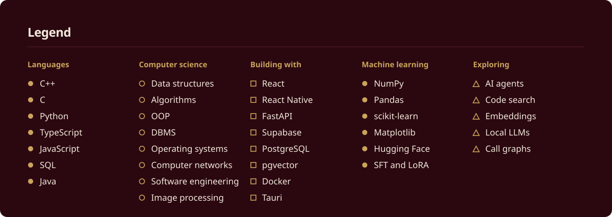

 

I'm a Computer Engineering student at Thapar Institute in Patiala. I like taking something tangled, like a huge codebase, a city full of potholes or the law as it applies to a 10-year-old, and building the tool that helps people find their way around it.

These days I'm deep in AI agents and code search. I write my algorithms in C++ and ship web apps in TypeScript, and I go looking for hackathons with hard problem statements.

 

<table>
  <tr>
    <td width="50%"></td>
    <td width="50%"></td>
  </tr>
  <tr>
    <td width="50%"></td>
    <td width="50%"></td>
  </tr>
</table>

### Field notes

- 🧭 Built an AI code-search agent that runs on a **4 GB laptop GPU** and finds the right function almost **2× as often** as a grep-based agent using the same model
- 🏆 Took real projects to **Smart India Hackathon 2026**, **Cosmicathon 2026** and the **BIOS Hackathon**, and took on a Paytm Payments Bank case at **INVESTI-CASE '26**, IIT Jammu
- ⚔️ **150+** problems solved in C++, all in [leetcode-solutions](https://github.com/bhavyammisra/leetcode-solutions), organised by topic
- 🗄️ Helped build the PostgreSQL + Supabase backend of an [orphan adoption management system](https://github.com/bhavyammisra/orphan-adoption-system)
- 📬 Open to **SDE internships** for summer 2027

### Contribution trail

<picture>
  <source media="(prefers-color-scheme: dark)" srcset="https://raw.githubusercontent.com/bhavyammisra/bhavyammisra/output/trail-dark.svg" />
  
</picture>

  

